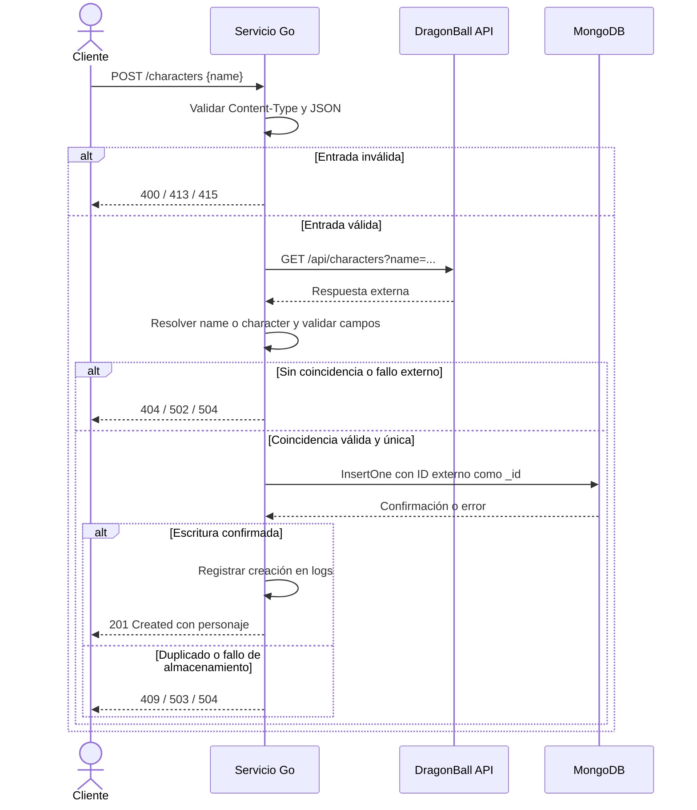

# DragonBall Service

Servicio en Go que busca personajes en [DragonBall API](https://web.dragonball-api.com/) y los persiste en MongoDB mediante `POST /characters`.

## Ejecutar con Docker

Requisitos: Docker con Compose v2, puertos 8080 y 27017 disponibles e Internet para descargar imágenes y consultar la API externa.

Desde la carpeta del proyecto:

```sh
docker compose up --build
```

Compose ejecuta los tests, compila el servicio e inicia la aplicación cuando MongoDB está disponible. El servicio queda en `http://localhost:8080`. No necesitas instalar Go para esta opción.

`Ctrl+C` detiene los servicios; los datos se conservan en un volumen. Para consultar los logs desde otra terminal:

```sh
docker compose logs -f app
```

## Crear un personaje

El endpoint recibe un único campo `name` de tipo string.

**Bash**

```sh
curl -i http://localhost:8080/characters \
  -H 'Content-Type: application/json' \
  -d '{"name":"Goku"}'
```

**PowerShell**

```powershell
Invoke-RestMethod -Method Post -Uri 'http://localhost:8080/characters' `
  -ContentType 'application/json' -Body '{"name":"Goku"}'
```

Respuesta de ejemplo: `201 Created`.

```json
{
  "id": 1,
  "name": "Goku",
  "race": "Saiyan",
  "gender": "Male",
  "ki": "60.000.000",
  "affiliation": "Z Fighter"
}
```

Se guardan estos seis campos en `dragonball.characters`. Crear de nuevo el mismo personaje devuelve `409 Conflict`, sin modificar el documento existente. Los valores de ejemplo dependen de la API externa.

La búsqueda exige una coincidencia exacta, ignorando mayúsculas y espacios al inicio o final. Se utiliza `name` de la respuesta externa; si falta o está vacío, se utiliza `character`.

Abrir `/characters` en el navegador hace un GET y devuelve `405 Method Not Allowed`: el endpoint admite únicamente POST.

### Cliente de consola opcional

Con Go 1.27.3 o superior instalado y el servicio iniciado:

```sh
go run ./cmd/client -name Piccolo
```

El cliente envía el mismo POST y muestra el personaje guardado o el error recibido. Para otra dirección, añade `-url http://localhost:8081`. Si el personaje ya existe, también devuelve el error de duplicado.

## Diseño y decisiones

- **Biblioteca estándar de Go** para HTTP, JSON y logs; el driver de MongoDB es la única dependencia directa.
- **Persistencia inyectada por función:** el handler recibe la operación de guardado; `mongo.go` implementa MongoDB y `cmd/api` conecta ambas piezas.
- **Unicidad en MongoDB:** el ID externo se almacena como `_id`. La base evita duplicados incluso ante solicitudes simultáneas.
- **Formato del proveedor:** `ki` se conserva como texto. El ID y los campos requeridos se validan antes de guardar.
- **Tiempos acotados:** la consulta externa tiene un límite de 5 segundos; consulta y guardado comparten 8 segundos, después de leer y validar el JSON. El contexto se propaga a ambas dependencias.

Las creaciones confirmadas generan un log con ID y nombre. Los errores 5xx registran su causa interna; el cliente recibe un mensaje genérico. El arranque comprueba la conexión con MongoDB y el servidor permite terminar las peticiones en curso durante el apagado.

## Errores y validación

Los errores del handler se devuelven como JSON:

```json
{"error":"Character is already stored"}
```

| HTTP | Motivo |
| --- | --- |
| 400 | JSON o nombre inválido; campos desconocidos o repetidos |
| 404 | No hay coincidencia exacta del personaje |
| 409 | Personaje ya almacenado |
| 413 | Cuerpo de petición mayor de 4096 bytes |
| 415 | Content-Type distinto de application/json |
| 502 | Error de conexión o respuesta inválida de DragonBall API |
| 503 | Error al guardar en MongoDB |
| 504 | Tiempo de espera agotado |

El JSON debe contener únicamente la clave `name`, escrita exactamente así y sin repeticiones. Tras recortar espacios, el nombre debe tener entre 1 y 200 bytes y no contener caracteres de control. Los textos externos requeridos no pueden estar vacíos ni contener caracteres de control. Las respuestas externas se limitan a 2 MiB; coincidencias ambiguas o incompletas se rechazan sin guardar.

## Configuración

| Variable | Valor por defecto | Uso |
| --- | --- | --- |
| `MONGODB_URI` | `mongodb://localhost:27017` | Go directo; Compose fija `mongodb://mongo:27017` |
| `HTTP_ADDR` | `:8080` | Dirección de escucha al ejecutar Go directamente |
| `DRAGONBALL_API_URL` | `https://dragonball-api.com/api` | URL base del proveedor en Go y Compose |
| `APP_PORT` | `8080` | Puerto del host publicado por Compose |
| `BIND_ADDRESS` | `127.0.0.1` | Interfaz del host para publicar la aplicación con Compose |

`DRAGONBALL_API_URL` debe ser una URL HTTP(S) sin credenciales, query ni fragmento; se valida al iniciar. Si apunta a un mock, su dirección debe ser accesible desde donde corre el servicio.

Compose lee `DRAGONBALL_API_URL`, `APP_PORT` y `BIND_ADDRESS` desde el entorno o un archivo `.env`. La aplicación Go lee sus variables del entorno del proceso. Ambos puertos de Compose se publican en loopback por defecto; MongoDB sin autenticación está destinado a desarrollo local.

### Ejecutar Go con MongoDB en Docker

Con Go 1.27.3 o superior, desde la carpeta del proyecto:

```sh
docker compose stop app
docker compose up -d --wait mongo
go run ./cmd/api
```

## Pruebas

```sh
go test ./...
go vet ./...
```

Los tests del repositorio cubren validación de entrada y configuración, selección del personaje, campos faltantes o corruptos, duplicados, fallos de dependencias y cancelación. Utilizan servidores HTTP simulados y funciones de guardado de prueba; no requieren MongoDB ni Internet. El Dockerfile también ejecuta los tests antes de compilar.

Durante la revisión se hicieron pruebas adicionales con MongoDB real, incluida la creación concurrente del mismo personaje, y fuzzing de entradas. Esas comprobaciones fueron validaciones adicionales y no forman parte de la suite anterior.

## Estructura

```text
cmd/
  api/main.go              Arranque, configuración y apagado
  client/main.go           Cliente de consola
internal/characters/
  characters.go           Handler, validación y consulta externa
  mongo.go                Persistencia en MongoDB
  characters_test.go      Pruebas del servicio
docs/
  sequence.md             Diagrama de secuencia
Dockerfile
docker-compose.yml
go.mod
go.sum
README.md
```

## Diagrama de secuencia

También disponible en [docs/sequence.md](docs/sequence.md).


