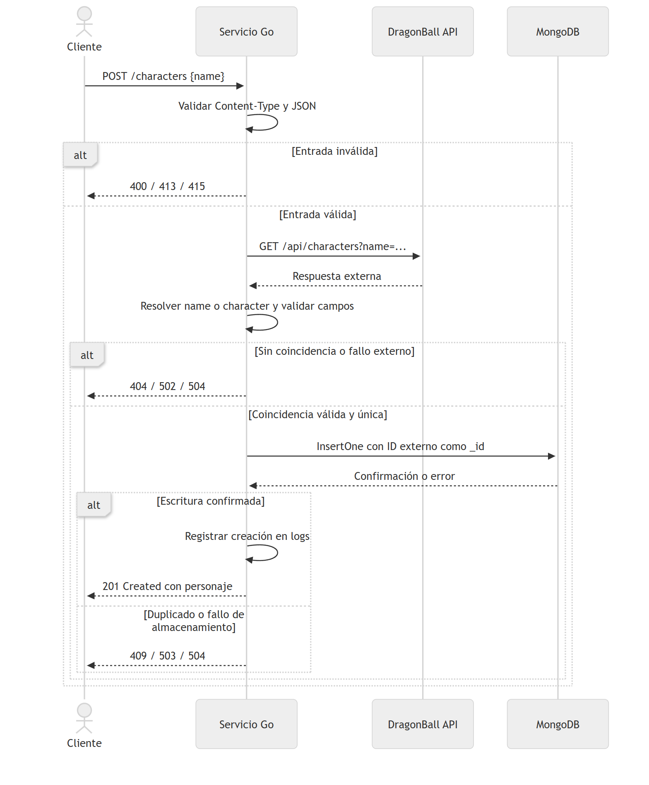
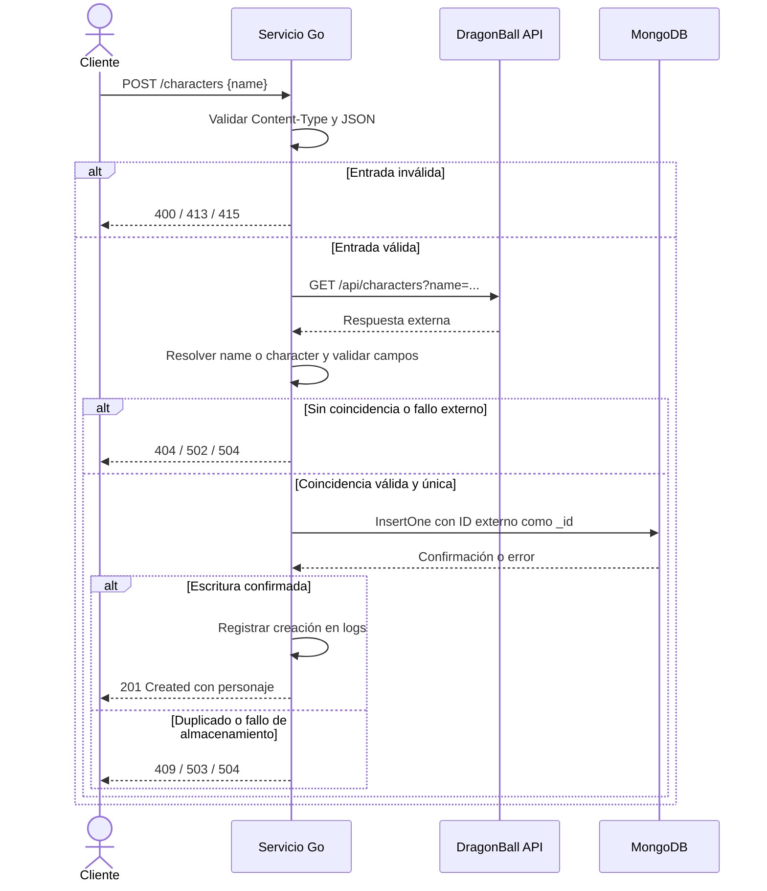

# Diagrama de secuencia

Flujo de `POST /characters`: validación de entrada, consulta a DragonBall API y persistencia en MongoDB. El cliente puede ser el cliente de consola o cualquier consumidor HTTP.

[Volver al README](../README.md#diagrama-de-secuencia).

## Fuente Mermaid

